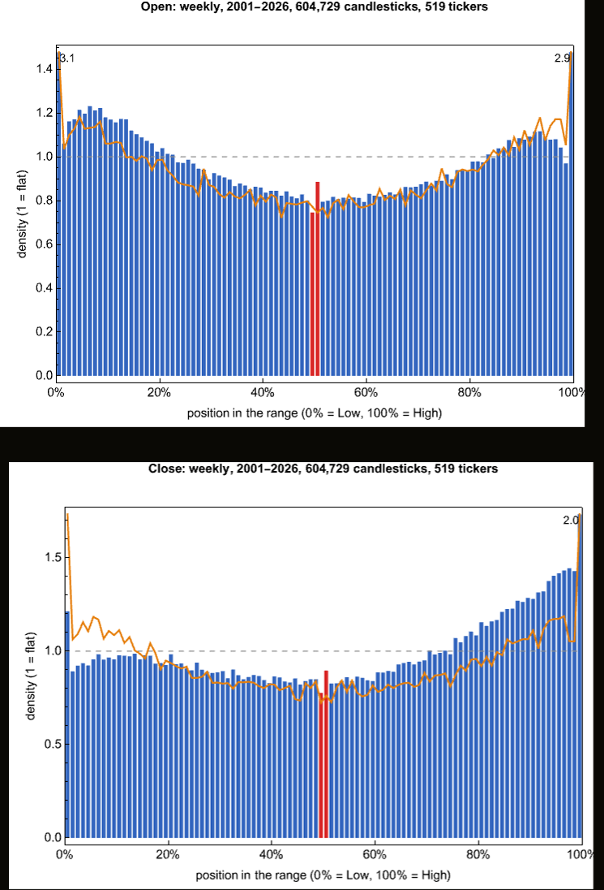
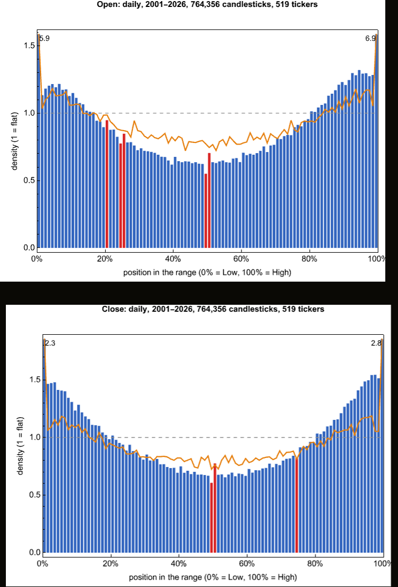

# Do the Open and the Close of a candlestick prefer certain places in its range? A study of 519 stocks

**Posted on Wolfram Community (2026-11-23):** [https://community.wolfram.com/t/do-the-open-and-the-close-of-a-candlestick-prefer-certain-places-in-its-range-a-study-of-519-stocks/28660](https://community.wolfram.com/t/do-the-open-and-the-close-of-a-candlestick-prefer-certain-places-in-its-range-a-study-of-519-stocks/28660). **Code and notebook:** [https://github.com/HenrickJeanty/RangePositionPreferences](https://github.com/HenrickJeanty/RangePositionPreferences) (MIT licence). The price data are built by the notebook from your own `FinancialData` access (see "Run it yourself").

## The question

For every candlestick, the position of the Open in its range is (Open − Low)/(High − Low): 0 when the Open is at the Low, 1 when it is at the High. The same for the Close. Are some positions preferred?

I measured it for every candlestick of 519 stocks: about 4.2 million daily, 875 thousand weekly and 202 thousand monthly candlesticks.

## Conclusion

1. **There is no preferred percentage.** The sharp spikes at 25 %, 33 %, 50 %, 67 % and 75 % that show up in the raw data are the price grid. Before 2001 prices were quoted in fractions, so a candlestick with a range of 2, 3 or 4 ticks can only have those positions (weekly candlesticks of 2000 and before: 152 bins stand out from their neighbours, at 1/5, 1/4, 1/3, 2/5, 1/2, 3/5, 2/3, 3/4, 4/5, ...). Daily ranges of a few cents do the same after 2001, and the spikes fade as the range gets wider: with no filter 27 daily bins stand out, with a range of at least 3 % of the price 8 do, and with at least 5 % only 3 (all at simple fractions such as 1/2). From 2001 on, the monthly histograms have none, and the weekly ones have only a faint bump at 50–51 % (about 10 % above its neighbours, with a dip just below it), most likely the grid again.
2. **The shape is a U, and any random walk gives a U.** Both the Open and the Close are found near the Low or the High more often than in the middle, because the Low and the High are places the price has been. A flat histogram is therefore the wrong "nothing special" reference. The real weekly Open follows a simulated driftless random walk closely.
3. **The Close leans toward the High.** The mean position of the Close is 0.534 for weekly and 0.550 for monthly candlesticks, and the Open's is 0.489 and 0.472. Daily is close to 0.5 (0.504 for the Close). This is what upward drift gives, and the sample is the current members of the S&P 500, so survivorship bias adds to it.
4. **The Open is at the exact Low or High much more often than the Close.** Weekly: 2.2 % (at the Low) and 2.1 % (at the High) for the Open against 0.6 % and 0.9 % for the Close. Monthly: 1.1 % and 1.0 % against 0.2 % and 0.5 %. Daily (range at least 3 % of the price): 5.0 % and 5.8 % against 1.4 % and 1.9 %. This survives the tick-grid filter. I have not tested why; one guess is that the opening print often never trades again.

**What this does not show:** whether any of it can be traded. It is a description of where prices end up inside their range, not a signal, and it is not investment advice. The random-walk reference is rough (a fixed 200 steps per candlestick, no volatility clustering), so differences in the broad shape, such as the daily U being deeper in the middle, should not be over-read.

## Figures



*Figure 1. Weekly candlesticks, 2001-2026 (604,729 of them). Bars: density of the position in the range (1 = a flat histogram); orange line: a simulated random walk; red: a bin that stands out from its neighbours. The end bars (clipped, value written on them) hold the candlesticks whose Open or Close is exactly at the Low or the High.*



*Figure 2. Daily candlesticks, 2001-2026, with a range of at least 3 % of the price (764,356 of them). The red bins (at 1/5, 1/4, 1/2 and 3/4) are what remains of the price grid.*

*Both pictures are static previews; in a notebook the plots show a tooltip for every bin (range, density, count, random walk, exact Low or High, spike). Replace them with screenshots from the front end before posting.*

## Run it yourself

Everything needed is in one folder, `RangePositionPreferences`, on GitHub: [https://github.com/HenrickJeanty/RangePositionPreferences](https://github.com/HenrickJeanty/RangePositionPreferences) (use *Code > Download ZIP*, or `git clone https://github.com/HenrickJeanty/RangePositionPreferences.git`). **The price data are not in it**: they come from `FinancialData`, whose terms apply, so I do not redistribute them. Instead the package builds the data from *your own* access to `FinancialData` and saves only ratios (no prices).

* `Kernel/RangePositionPreferences.wl`: the code (four functions, each with a usage message).
* `Notebooks/RangePositionPreferences.nb`: loads the code, builds the data and runs every analysis of this post, with every option spelled out so you can change it.
* `Tickers.txt`: the 519 tickers of the study (the constituents of the S&P 500 in November 2026).
* `Tests/RangePositionPreferences.wlt`: the tests, on made-up candlesticks (no data, no internet).

Download the folder and keep its subfolders together. Open the notebook, evaluate section 1 (load the code), then section 2 once: it downloads the daily prices of every ticker once with `FinancialData`, makes the daily, weekly and monthly candlesticks and saves, in `Data/`, only the position of the Open and of the Close in the range, the relative range and the year of every candlestick. **It takes about 20 seconds for each ticker, about 3 hours for all 519, so try 10 tickers first.** Then sections 3 to 5 reproduce the results. Or, in a notebook of your own:

```wolfram
(* Load the code: change the path to the folder you downloaded *)
Get["path/to/RangePositionPreferences/Kernel/RangePositionPreferences.wl"]
```

```wolfram
(* Build the data for 10 tickers (about 4 minutes; needs an internet connection and FinancialData). Remove the Take for all 519. *)
buildRangePositionData[
  "path/to/RangePositionPreferences/Data",
  "Tickers" -> Take[Import["path/to/RangePositionPreferences/Tickers.txt", "List"], 10],
  "Periods" -> {"daily", "weekly", "monthly"},
  "Retries" -> 2,
  "Overwrite" -> False
]
```

```wolfram
(* Read the saved weekly positions, make the histograms (from 2001 on) and draw them *)
weeklyCollected = collectRangePositions[
  "weekly",
  "Tickers" -> Automatic,
  "Loader" -> Automatic,
  "CacheFile" -> "path/to/RangePositionPreferences/Data/RangePositions_weekly.wxf"
];

weeklyResult = rangePositionPreferences[
  weeklyCollected,
  "Bins" -> 100,
  "FromYear" -> 2001,
  "ToYear" -> Automatic,
  "MinRelativeRange" -> 0,
  "SpikeThreshold" -> 5,
  "Null" -> True,
  "NullSteps" -> 200,
  "NullPaths" -> 100000,
  "NullDrift" -> 0,
  "Seed" -> 1
];

showRangePositionPreferences[
  weeklyResult,
  "Which" -> "Both",
  "ImageSize" -> 520,
  "Theme" -> "Light",
  "ShowNull" -> True,
  "MarkSpikes" -> True,
  "YMax" -> Automatic
]
```

For daily candlesticks use `"daily"` and the daily file, and add `"MinRelativeRange" -> 0.03`. To see the price grid, use `"FromYear" -> 1900` and `"ToYear" -> 2000`. Move the mouse over a bin to see its range, density, count, the random walk and the share exactly at the Low or the High.

**The numbers in this post** come from the 519 tickers and the prices of November 2026. A build on another day gives slightly different numbers, and a build with few tickers is noisier (a handful of tickers gives a few thousand candlesticks: do not read spikes into it).

**Other tickers or another source.** `collectRangePositions["weekly", "Tickers" -> {"AAPL", "MSFT"}]` reads tickers directly with `FinancialData` (daily prices merged into weeks that start on Monday, into months or into years). Or pass your own `"Loader"`: a function of a ticker and a period that gives a list of associations with the keys `Date`, `Open`, `High`, `Low` and `Close`.

**About the sample.** The 519 tickers are the constituents of the S&P 500 when I downloaded the prices (November 2026): current members, so stocks that left the index are not in the sample. The saved positions are rounded to 6 decimals (so that a position of exactly 1/2 is exactly 0.5 and is always counted in the same bin) and do not depend on whether the prices were adjusted for splits and dividends. The code is MIT licensed.

## Method, in short

* `collectRangePositions` keeps, for every candlestick that has a range (High > Low, Open and Close between them), the position of the Open and of the Close, the relative range (High − Low)/((High + Low)/2) and the year.
* `rangePositionPreferences[collected, "FromYear" -> 2001, "MinRelativeRange" -> 0.03, ...]` makes the 100-bin histograms, simulates the random walk, gives the share exactly at the Low and at the High, and flags the bins that differ from the median of their 4 nearest neighbours by more than 5 standard deviations of a count.
* `showRangePositionPreferences[result]` draws them.
* The years from 2001 on avoid the fractional-price era; for daily candlesticks `"MinRelativeRange"` (range as a fraction of the price) keeps out candlesticks whose range is only a few ticks.

## Checks still to do before posting

* Ask Wolfram whether the saved ratios (no prices) may be shared, if you ever want to offer them as a download; for now they are not included.
* Replace the two preview figures with front-end screenshots.
